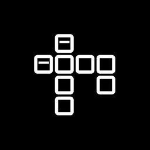
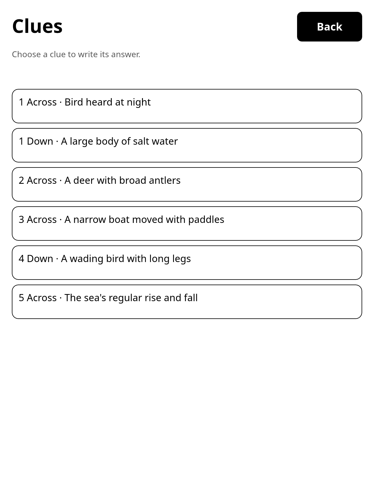

<div align="center">



# Crossword

**Mini crosswords and your puzzles**

[](https://github.com/PrimitiveOS/kindle-primitive-crossword/actions/workflows/ci.yml)
[](https://github.com/PrimitiveOS/kindle-primitive-crossword/releases)
[](https://github.com/PrimitiveOS/kindle-primitive-crossword/tags)
[](LICENSE)
[](https://github.com/PrimitiveOS/kindle-primitive-crossword/stargazers)
[](https://primitiveos.github.io/kindle-primitive-catalog/v1/index.json)

[**Download**](https://github.com/PrimitiveOS/kindle-primitive-crossword/releases/latest) ·
[**Install guide**](INSTALL.md) ·
[**Changelog**](CHANGELOG.md)

</div>

---

Play original mini crosswords or open an unlocked .puz file from your Kindle. Read clues, type answers, check mistakes, and reveal answers one clue at a time.

## Quick start

After setting up PrimitiveOS, open **Store** from Primitive Launcher. Choose **Crossword** under **Apps**,
tap **Get**, and open it from the Launcher grid. The [install guide](INSTALL.md) also covers the standalone USB package.

## Screenshots

<table>
<tr>
<td align="center"><br><sub>Start an original mini</sub></td>
<td align="center"><br><sub>Browse the clue list</sub></td>
<td align="center"><br><sub>Enter a word in dark mode</sub></td>
</tr>
</table>

<sub>Mac simulation captures at 1264 × 1680 pixels.</sub>

## Highlights

- **Two original puzzles.** Start with “By the water” or “At the desk.”
- **Check and Reveal.** Check highlights mistakes. Reveal fills the selected answer after confirmation.
- **Import your own puzzles.** Copy a standard unlocked `.puz` with single-letter cells to `documents/`, then choose **Puzzles → Import .puz**.

## Develop locally

Keep `doannt-kindle-tools` and `doannt-kindle-launcher` beside this checkout, then run the following from this repo.

```sh
cargo test --offline --locked --workspace
cargo run --offline --locked -p crossword-desktop
```

The desktop target writes previews to `build/previews/`. The desktop simulation exercises entry, clue selection, and reveal.
On an ARMHF Kindle Oasis 3 running firmware 5.18.2, Crossword opened and closed the Clues list, leaving the
original puzzle unchanged, and returned to Launcher. See the [device notes](docs/device-notes.md) for the
verification checklist.

## Status

| Device | Status |
|---|---|
| Kindle Oasis 3 (1264 × 1680, firmware 5.18.2) | Tested on hardware |

**Current version: 0.1.1.** Changes are in [CHANGELOG.md](CHANGELOG.md).

## Downloads

The badge at the top shows the number of Store downloads. It counts GitHub downloads of this app's release packages, across all versions and architectures, and is refreshed daily from the [Store catalog](https://primitiveos.github.io/kindle-primitive-catalog/v1/index.json).

## Documentation

[Install guide](INSTALL.md) · [Changelog](CHANGELOG.md) · [Device notes](docs/device-notes.md)

## Licence

Copyright (C) 2026 Doan Nguyen.

Code is licensed under [PolyForm Noncommercial 1.0.0](LICENSE). The original documentation, pictures, and bundled puzzles are licensed under [CC BY-NC-SA 4.0](LICENSE-DOCS). The `.puz` reader follows the [puzpy format reference](https://github.com/alexdej/puzpy/blob/master/FileFormat.md).
