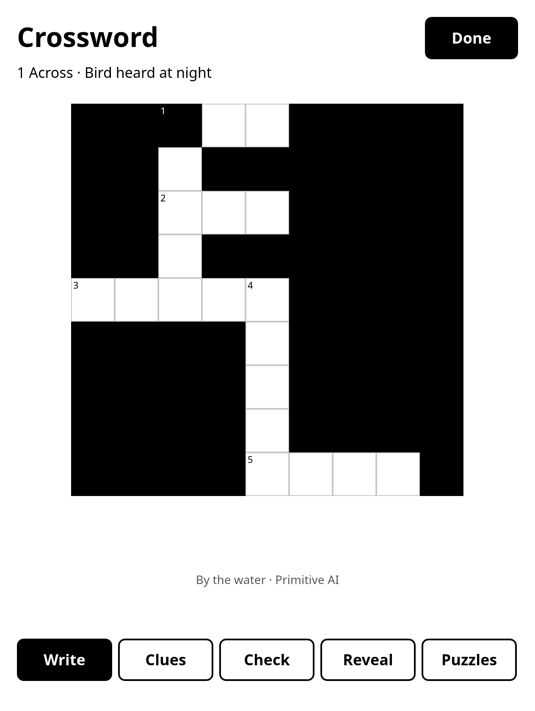
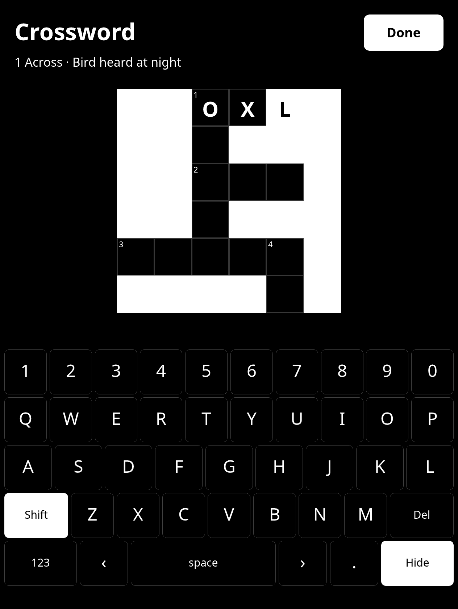

<div align="center">

# Primitive Crossword

**Original mini crosswords and your own puzzles on Kindle.**

[**Install guide**](INSTALL.md) · [**Device notes**](docs/device-notes.md) · [**Changelog**](CHANGELOG.md)

</div>

---

Solve an original mini or open a standard Across Lite `.puz` file. Choose a square or clue and enter letters with the on-screen keyboard. The app saves the open puzzle and your progress.

## Screenshots

<table>
<tr>
<td align="center"><br><sub>Start an original mini</sub></td>
<td align="center"><br><sub>Browse the clue list</sub></td>
<td align="center"><br><sub>Enter a word in dark mode</sub></td>
</tr>
</table>

<sub>Mac simulation captures at 1264 × 1680 pixels.</sub>

## Highlights

- **Two original puzzles.** Start with “By the water” or “At the desk.”
- **Check and Reveal.** Check highlights mistakes. Reveal fills the selected answer after confirmation.
- **Import your own puzzles.** Copy a standard unlocked `.puz` with single-letter cells to `documents/`, then choose **Puzzles → Import .puz**.

## Quick start

1. Find the local ARMHF package and USB installation steps in the [install guide](INSTALL.md).
2. Extract the package, copy the `crossword` and `documents` folders to your jailbroken Kindle’s user storage, and eject it.
3. Open Primitive Crossword from Primitive Launcher. **Done** returns to the launcher grid.

## Develop locally

Keep `doannt-kindle-tools` and `doannt-kindle-launcher` beside this checkout, then run the following from this repo.

```sh
cargo test --offline --locked --workspace
cargo run --offline --locked -p crossword-desktop
```

The desktop target writes previews to `build/previews/`. The desktop simulation exercises entry, clue selection, and reveal. Physical Kindle testing is pending. See the [device notes](docs/device-notes.md) for the verification checklist.

## Licence

Copyright (C) 2026 Doan Nguyen.

Code is licensed under [PolyForm Noncommercial 1.0.0](LICENSE). The original documentation, pictures, and bundled puzzles are licensed under [CC BY-NC-SA 4.0](LICENSE-DOCS). The `.puz` reader follows the [puzpy format reference](https://github.com/alexdej/puzpy/blob/master/FileFormat.md).
